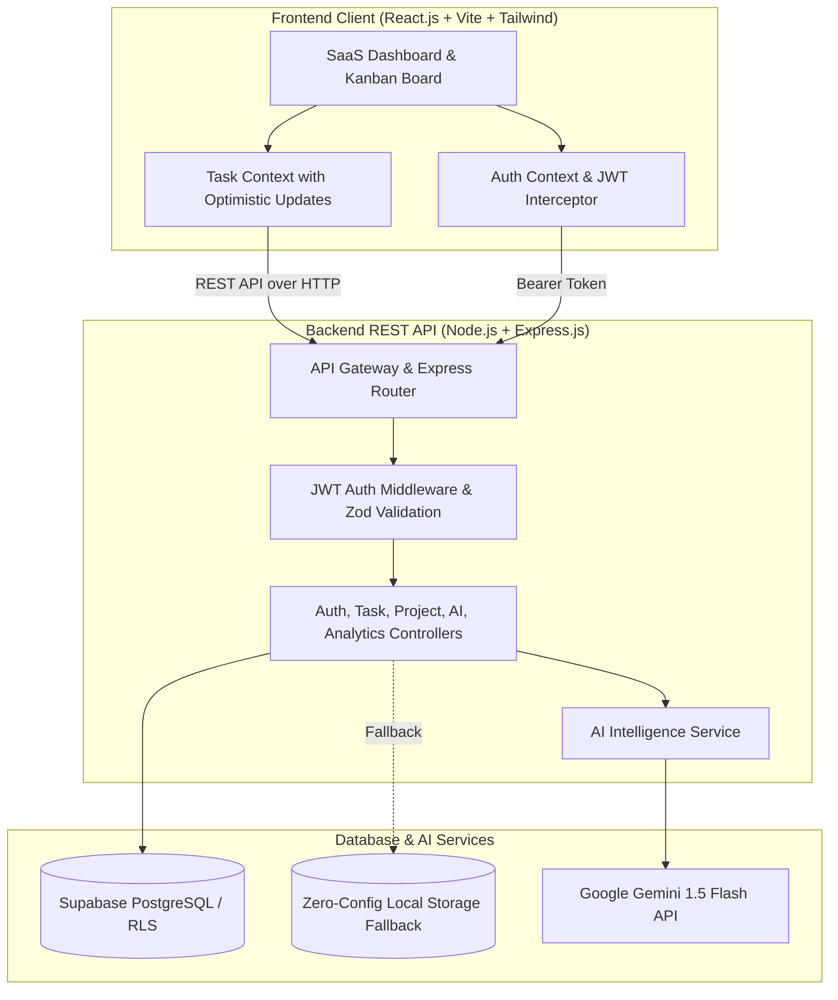

# TaskFlow AI - AI-Powered Task Management SaaS

##  Executive Summary

**TaskFlow AI** is a production-grade, full-stack productivity SaaS designed to streamline modern engineering and product workflows. It merges a responsive Kanban board with autonomous AI capabilities—such as automated task specification generation, predictive priority scoring (1-100), and daily standup synthesis—backed by multi-tenant PostgreSQL security via Supabase Row-Level Security (RLS).

### Key Highlights
-  **Zero-Configuration Ready**: Evaluators can clone and run `npm run dev` immediately. Includes a built-in instant local storage engine pre-seeded with realistic SaaS tasks, projects, and a 1-click **"Instant Demo Sign In"** button.
- **Supabase Cloud Native**: Ready-to-execute `supabase_schema.sql` script with custom PostgreSQL enums, triggers, indexes, and tenant-isolated Row Level Security (RLS) policies.
-  **Autonomous AI Engine**: Dual-mode AI system supporting live **Google Gemini 1.5 Flash** with an offline heuristic NLP engine fallback.

---

## System Architecture



---

## Essential Features Breakdown

### 1. Frontend – React.js (Vite + Tailwind CSS + Lucide Icons)
- **Responsive SaaS Dashboard**: Clean dark-mode workspace layout with real-time sprint statistics, urgency radars, and project progress meters.
- **Authentication**: JWT login and registration with validation, password security, and an **Instant Demo Login** button for instant evaluation.
- **Interactive Kanban Board**: 4-stage delivery pipeline (*To Do*, *In Progress*, *In Review*, *Completed*) featuring smooth HTML5 drag-and-drop with optimistic state updates.
- **Task Creation & Deep Editing**: Modal supporting title, description, project grouping, due dates, estimated hours, custom tags, and dynamic subtask checklists.
- **Instant Search & Advanced Filtering**: Multi-parameter search by keyword, project, status, priority, and sorting by creation date, due date, AI score, or title.
- **Productivity Analytics Dashboard**: Visual completion rate gauges, velocity score metrics, priority breakdown bars, project velocity meters, and upcoming deadlines.

### 2. Backend – Node.js + Express.js
- **RESTful API**: Clean controller-service-route modular architecture.
- **JWT Authentication**: Password hashing with `bcryptjs` and stateless `jsonwebtoken` verification with 7-day expiration.
- **User-Specific Multi-Tenant Scoping**: All queries are securely scoped to `req.user.id`.
- **Input Validation**: Request validation guarding against missing fields, invalid emails, and unsupported enum states.
- **Centralized Error Handling**: Unified error middleware returning standard JSON responses (`{ success: false, error: "..." }`).

### 3. Database – Supabase (PostgreSQL)
- **Tables**: `profiles`, `projects`, and `tasks`.
- **Enums**: Custom PostgreSQL enums `task_status` and `task_priority`.
- **Row Level Security (RLS)**: Enforces that users can only select, insert, update, or delete their own rows (`auth.uid() = user_id`).
- **Triggers**: Automated `updated_at` timestamps on row mutation.
- **Indexes**: Optimized B-tree indexes on `user_id`, `project_id`, `status`, `priority`, and `due_date`.

### 4. AI Features (Google Gemini 1.5 Flash + Smart Heuristic Engine)
1. **AI Task Description Generator**: Converts a simple title (e.g. *"Set up Stripe billing webhook"*) into a structured technical specification with objectives, acceptance criteria, and suggested subtasks.
2. **Smart Task Prioritization**: Analyzes task complexity, urgency keywords, and due date proximity to assign a priority (`urgent`, `high`, `medium`, `low`), an AI score (1-100), and an actionable rationale.
3. **Task Summary Generation (AI Standup Pulse)**: Analyzes the current backlog and active sprint to generate a daily standup digest with accomplishments, focus streams, delivery blockers, and agile coaching advice with a **"Copy for Slack"** button.

---

##  Project Directory Structure

```text
D:\taskflow-ai\
├── README.md                      # Comprehensive project documentation
├── supabase_schema.sql            # Full PostgreSQL DDL schema with RLS & triggers
├── package.json                   # Root monorepo script orchestrator
├── .gitignore                     # Git configuration ignoring dependencies & secrets
├── backend/                       # Node.js + Express.js REST API
│   ├── package.json
│   ├── .env.example               # Environment variables template
│   ├── .env                       # Local environment configuration
│   └── src/
│       ├── config/
│       │   ├── db.js              # Supabase client + local fallback adapter
│       │   └── localDb.js         # In-memory & file-backed store for 0-config testing
│       ├── controllers/
│       │   ├── authController.js  # Register, Login, Me, DemoLogin
│       │   ├── taskController.js  # Task CRUD, status movement, filtering
│       │   ├── projectController.js# Project CRUD & task counts
│       │   ├── aiController.js    # AI endpoint handlers
│       │   └── analyticsController.js # Velocity & metrics computation
│       ├── middleware/
│       │   ├── authMiddleware.js  # JWT Bearer verification
│       │   ├── errorMiddleware.js # Centralized 404 & error handlers
│       │   └── validateMiddleware.js # Request schema validators
│       ├── routes/
│       │   ├── authRoutes.js
│       │   ├── taskRoutes.js
│       │   ├── projectRoutes.js
│       │   ├── aiRoutes.js
│       │   └── analyticsRoutes.js
│       ├── services/
│       │   └── aiService.js       # Gemini API integration & NLP heuristics
│       └── server.js              # Express app bootstrap & healthcheck
└── frontend/                      # React.js + Vite Client
    ├── package.json
    ├── vite.config.js             # Vite config with backend API proxy
    ├── tailwind.config.js         # Tailwind CSS theme configuration
    ├── postcss.config.js
    ├── index.html                 # HTML5 entry with Plus Jakarta Sans typography
    └── src/
        ├── api/
        │   └── client.js          # Fetch client with automatic JWT injection
        ├── components/
        │   ├── common/            # Navbar, Sidebar, Modal, Badges
        │   ├── kanban/            # KanbanBoard, KanbanColumn, TaskCard
        │   ├── tasks/             # TaskModal, TaskFilterBar, TaskListView
        │   ├── projects/          # ProjectModal
        │   ├── ai/                # AISummaryModal
        │   └── analytics/         # AnalyticsDashboard
        ├── context/
        │   ├── AuthContext.jsx    # Session & user state
        │   └── TaskContext.jsx    # Tasks, projects, filters, optimistic updates
        ├── pages/
        │   ├── AuthPage.jsx       # Login, Register & Demo Sign In
        │   ├── DashboardPage.jsx  # Overview metrics & AI pulse
        │   ├── KanbanPage.jsx     # Full-screen Kanban workflow
        │   ├── TasksPage.jsx      # Advanced table view
        │   └── AnalyticsPage.jsx  # Detailed productivity metrics
        ├── App.jsx                # Layout & modal orchestration
        ├── main.jsx               # React entry point
        └── index.css              # Global styles & scrollbar design
```

---

## Quick Start Guide

### Step 1: Install Dependencies
Open your terminal in `D:\taskflow-ai`:

```bash
cd D:\taskflow-ai
npm run install:all
```
*(Or install separately: `npm install` in both `backend` and `frontend` folders)*.

### Step 2: Start Both Servers
From `D:\taskflow-ai`, run:

```bash
npm run dev
```

- **Frontend**: `http://localhost:3000`
- **Backend API**: `http://localhost:5000`
- **API Health Check**: `http://localhost:5000/api/health`

### Step 3: Test Immediately with 1-Click Demo Login
1. Open `http://localhost:3000` in your browser.
2. Click the purple **"Instant Demo Sign In"** button.
3. You are immediately logged in as **Alex Rivera (Senior Product Manager)** with ready-made demo tasks, projects, and Kanban cards!

---

##  Supabase Cloud Integration (Optional)

The application runs seamlessly out-of-the-box using the built-in local database. To connect a live Supabase PostgreSQL database:

1. Create a free project on [Supabase](https://supabase.com).
2. Go to the **SQL Editor** tab in Supabase.
3. Copy the entire contents of [`supabase_schema.sql`](./supabase_schema.sql) and click **Run**.
4. Open `D:\taskflow-ai\backend\.env` and paste your project credentials:
   ```env
   SUPABASE_URL=https://your-project-id.supabase.co
   SUPABASE_KEY=your_supabase_anon_or_service_role_key
   ```
5. Restart the backend. The server will output:
   ```
   [Database] Connected to live Supabase project: https://your-project-id.supabase.co
   ```


## REST API Reference

All protected endpoints require `Authorization: Bearer <JWT_TOKEN>` header.

| Method | Endpoint | Description | Auth Required |
|---|---|---|:---:|
| `GET` | `/api/health` | Service health status & DB mode | No |
| `POST` | `/api/auth/register` | Register new user account | No |
| `POST` | `/api/auth/login` | Sign in with email & password | No |
| `POST` | `/api/auth/demo` | Instant 1-click evaluator login | No |
| `GET` | `/api/auth/me` | Fetch authenticated user profile | **Yes** |
| `GET` | `/api/tasks` | Get all user tasks (supports search, filter, sort) | **Yes** |
| `GET` | `/api/tasks/:id` | Fetch single task by ID | **Yes** |
| `POST` | `/api/tasks` | Create a new task | **Yes** |
| `PUT` | `/api/tasks/:id` | Update task fields | **Yes** |
| `PATCH` | `/api/tasks/:id/status` | Update Kanban status column | **Yes** |
| `DELETE` | `/api/tasks/:id` | Delete task | **Yes** |
| `GET` | `/api/projects` | Get user projects with task counts | **Yes** |
| `POST` | `/api/projects` | Create a new project | **Yes** |
| `PUT` | `/api/projects/:id` | Update project details | **Yes** |
| `DELETE` | `/api/projects/:id` | Delete project | **Yes** |
| `POST` | `/api/ai/generate-description` | Generate AI task spec & subtasks | **Yes** |
| `POST` | `/api/ai/smart-prioritize` | Calculate AI score & rationale | **Yes** |
| `POST` | `/api/ai/generate-summary` | Generate daily standup summary | **Yes** |
| `GET` | `/api/analytics` | Fetch productivity metrics & velocity | **Yes** |

---

## Automated Testing

The backend includes a comprehensive test suite covering authentication, field allowlists, task CRUD, and AI features.

Run all automated tests with:
```bash
npm test
```
Or directly within the backend directory:
```bash
cd backend
npm test
```

### Test Coverage Highlights:
- **Authentication**: Registration validation, duplicate email rejection (409), password hashing, demo login, JWT issuance and 401 unauthorized checks.
- **Task CRUD & Field Allowlist Security**: Task creation, schema validation, status transitions, and protection against malicious `user_id` reassignments (403 Forbidden).
- **AI Engine**: Specification generator, smart priority score computation (1-100), and daily standup synthesis.
- **Healthcheck & Security**: Live database connectivity verification and CORS allowlist enforcement.

